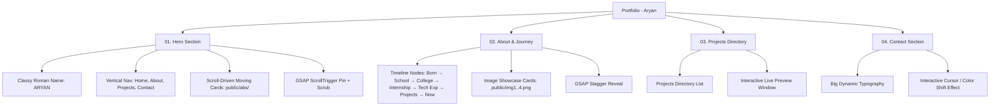

# Portfolio Roadmap & Mindmap

## Project Vision
A modern, dark-mode, high-aesthetic portfolio for **Aryan** (Web Developer & AI Engineer), featuring scroll-driven GSAP animations, elegant Roman/serif typography, and an interactive digital showcase based directly on the hand-drawn concept sketch.

---

## Architecture Mindmap

---

## File Structure & Status

- **Hero Component**: `src/components/Hero/Hero.tsx` ✅ Completed
  - Uses `Cormorant Garamond` Roman serif + `Montserrat`
  - Responsive nav with direct link to `Resume.pdf`
  - Scroll-pinned scrub animation with 3 image cards (`/abs/image*.png`)
  - Mobile optimized layout (< 768px)
- **About Component**: `src/components/About/About.tsx` ✅ Completed
  - Winding infographic road with interactive milestone pins
  - Populated with Aryan's actual credentials from Resume.pdf (PSIT Kanpur B.Tech IT, Playwright & pytest QA, 150+ DSA LeetCode, Rift Hackathon Semifinalist, Mi:RAG & ThreadLine, DeepLearning.AI Certifications)
  - Accessible ESC-closable modal and touch-friendly mobile hitbox
- **Projects Component**: `src/components/Projects/Projects.tsx` ✅ Completed
  - 3-column desktop layout (rotated strip, directory, live browser preview)
  - Mobile horizontal scroll tabs for instant one-thumb navigation
  - Live full-screen iframes for Mi-RAG, GitFixAI, ThreadLine, WordLens + dedicated hardware overview for AetherEye
- **Contact Component**: `src/components/Contact/Contact.tsx` ✅ Completed
  - Three.js 3D volumetric cloud canvas background responding to scroll
  - Cursive "Contact Me" calligraphy in `Pinyon Script` with swaying heart charms
  - Integrated real contact info from Resume.pdf: `aryansingh7598@gmail.com`, `+91 7007839057`, `linkedin.com/in/aryan64`, `/Resume.pdf` download button
  - Black and white liquid wave with 6 glistening 4-pointed diamond stars

